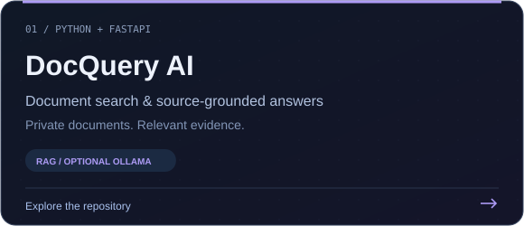
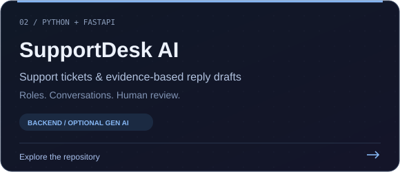
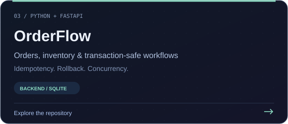
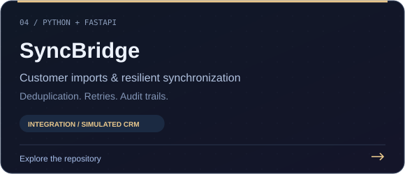
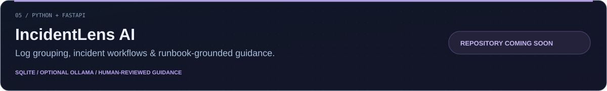

  

  <strong>Software Engineer · Python & SQL · Exploring Generative AI</strong>

  <a href="#about-me">About</a> &nbsp; / &nbsp;
  <a href="#technical-focus">Technical focus</a> &nbsp; / &nbsp;
  <a href="#project-shelf">Projects</a> &nbsp; / &nbsp;
  <a href="#next-chapter">Next chapter</a>

## About me

I'm **Rukhsar Jamadar**, a **Software Engineer** interested in solving practical problems and building useful applications.

I'm deepening my knowledge of **Python, SQL, and backend development**, while exploring how **Generative AI** can improve software and everyday workflows.

I use this space to share projects, document what I learn, and improve through hands-on development.

> **My approach:** understand the problem, build a clear solution, test the edges, and keep improving.

## Technical focus

  

- **Python:** writing maintainable code with clear functions, object design, typing, and tests.
- **SQL and databases:** querying data, understanding relationships, and exploring database integration.
- **Backend development:** strengthening my understanding of HTTP, REST APIs, FastAPI, and validation.
- **Generative AI:** exploring embeddings, document retrieval, model integration, and evaluation.
- **Problem solving:** practising data structures, algorithms, and complexity analysis.
- **Developer workflow:** using Git, debugging systematically, and documenting projects clearly.

## Project shelf

Python applications built with **FastAPI and SQLite**, exploring reliable backend workflows and practical GenAI integration.

  
  

  
  

  

<strong>Project descriptions and links</strong>

- **[DocQuery AI](https://github.com/Rukhs-j/docquery-ai)** — Document search & source-grounded answers.
- **[SupportDesk AI](https://github.com/Rukhs-j/Supportdesk-ai-python)** — Support tickets & evidence-based reply drafts.
- **[OrderFlow](https://github.com/Rukhs-j/orderflow-backend-python)** — Orders, inventory & transaction-safe workflows.
- **[SyncBridge](https://github.com/Rukhs-j/customer-sync-service)** — Customer imports & resilient synchronization.
- **IncidentLens AI** — log grouping, incident tracking and optional AI troubleshooting guidance. Repository coming soon.

*AI features use an offline retrieval demo by default, with optional Ollama integration. Payments and CRM operations are simulated.*

[Browse all my repositories →](https://github.com/Rukhs-j?tab=repositories)

## Next chapter

  

My next goals are to:

- Build a Python application with meaningful automated tests.
- Develop a backend API connected to a relational database.
- Create a document search tool and extend it with retrieval-augmented generation.
- Evaluate application correctness, reliability, and performance.
- Strengthen my problem-solving and software design skills.

I want to understand **why a solution works**, explain its tradeoffs, and improve it as requirements grow.

## Let's connect

I'm interested in exchanging project feedback, discussing software development, and learning with other developers.

[Explore my GitHub →](https://github.com/Rukhs-j) &nbsp; · &nbsp; [Browse my repositories →](https://github.com/Rukhs-j?tab=repositories)

  

